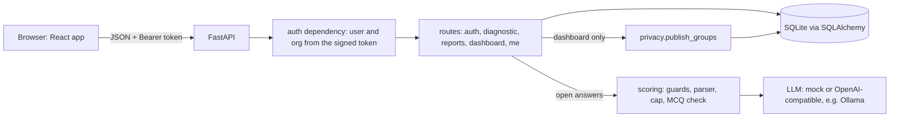

# AI Pulse

[](https://github.com/anilgehlotn/ai-pulse/actions/workflows/ci.yml)

## Live demo

- **Demo:** https://ai-pulse-lqmd.onrender.com
- **API health:** https://ai-pulse-api-9jjz.onrender.com/health

Sign in with any [demo account](#demo-accounts), password `pulse123`. Try:

- `asha@northwind.test`: the leadership dashboard.
- `ravi@consult.test`, then **Bluepeak Retail**: every team is too small, so no numbers are shown.
- `rohan@northwind.test`: an employee report in the Exposed quadrant.

It runs on Render's free plan. The API sleeps when idle, so the first sign-in can take up to a minute, and the demo
data resets whenever the API restarts. AI scoring runs in mock mode on the demo; to score with a real model, run it
locally with Ollama (see [Can the AI parts be trusted?](#can-the-ai-parts-be-trusted)).

AI Pulse measures how well a company's people use AI at work. Employees take a short diagnostic that adapts to their
role and seniority and get a personal report. Leadership sees team-level results, with a privacy rule that stops any
individual from being identified.

## Quick start

### Docker (one command)

```bash
cp .env.example .env    # then put a real SECRET_KEY in .env (the file says how to generate one)
make up                 # same as: docker compose up --build
```

Open http://localhost:8080. The API is on http://localhost:8000. The first start loads the demo data; later starts
keep whatever is in the database (it lives on the `aipulse-data` volume). `make down` stops everything.

**Deploying the backend image elsewhere (e.g. Render):** the container runs `backend/start.sh`, which seeds an empty
database and then starts the API on `$PORT` (default 8000). Don't override the start command on the platform.

### Local

Needs Python 3.12 and Node 20.

```bash
make setup      # backend/.venv + pip install, and npm ci
make seed       # wipe the local database and load the demo data
make backend    # http://localhost:8000
make frontend   # http://localhost:5173 (second terminal)
```

In development the login page has a **Demo accounts** box: click an email to fill in the form.

### Demo accounts

Every password is `pulse123`.

| Account | What it shows |
|---|---|
| asha@northwind.test | Northwind admin. Full dashboard: Sales and Support shown, small teams merged into Other teams, Sales listed under **Act first** (Exposed). |
| ravi@consult.test | Belongs to two organizations. Admin at Bluepeak, where every team is too small, so the dashboard shows no numbers. Employee at Northwind with a report. |
| rohan@northwind.test | Employee in Sales. Report in the **Exposed** quadrant (adoption 3, safety 2) with a data-handling tip. |
| priya@northwind.test | Employee in Support who only answered two questions. Good for trying **Delete all my answers**. |
| meera@bluepeak.test | Bluepeak admin. Same fully hidden dashboard as Ravi sees there. |
| dev@northwind.test | Engineering lead. Gets every engineering question (leads used to get only junior ones); report is **Leading**. |

`make seed` resets everything, including anything you deleted.

## What I found wrong

The codebase came from a developer who had left. It ran, but these were real problems, each checked against the
original code (commit `5e3713c`).

**Data leaking between organizations**
- `GET /dashboard?org_id=2` trusted the URL. Asha (Northwind admin) got Bluepeak's dashboard with HTTP 200.
- The test meant to catch this, `test_admin_cannot_see_other_org`, requested the admin's *own* org (`org_id=1`), so it
  could never fail.
- `/auth/select-org` issued a token for any `org_id` without checking membership. Later requests did check, so this
  was a missing second lock rather than a leak on its own.

**Security**
- A production-looking `SECRET_KEY` was committed in `backend/.env`, and the app silently fell back to a default key.
- Passwords were unsalted SHA-256.
- CORS allowed every origin, method and header.
- Login skipped the password check for unknown emails. Once passwords used bcrypt, that made unknown emails
  measurably faster than wrong passwords, which revealed who has an account.

**Wrong numbers**
- Dashboard averages divided the sum of every answer by the department's *headcount*, not by respondents.
- Seniority was compared as strings. `"lead" < "mid"`, so leads only got junior questions.
- The dashboard used different level thresholds from the personal report: 2.67 was "Practitioner" on the dashboard
  and "Exploring" on the report.
- Teams with no answers showed `0.0` and "Beginner" instead of "Not assessed".

Northwind and Bluepeak dashboards with the original code and data, against what that data should have shown:

| Team | Original dashboard | Correct value | Why |
|---|---|---|---|
| Northwind Sales | 2.67, Practitioner | 4.0 | Vikram's 8 points divided by 3 employees instead of 1 respondent |
| Northwind Support | 1.67, Exploring | 2.5 | Priya's 5 points divided by 3 employees |
| Northwind Engineering | 0.0, Beginner | Not assessed | Nobody had answered |
| Bluepeak Customer Care | **7.0, Leader**, on a 1–5 scale | 3.5 | Kabir's two answers (3 + 4) divided by 1 employee |

Every one of those teams had a single respondent, and the top risks were exact per-answer counts
(`customer_data_shared: 1`). Under the current privacy rule, all of them are hidden. With today's demo seed,
Northwind shows Sales 2.78, Support 3.08 and Other teams 2.8, with an overall 2.9 across 16 respondents.

**AI output trusted blindly**
- The model's reply went straight into the database. A score of 7, the string `"four"` and made-up flags got through.
- A reply wrapped in a fenced json block crashed the submit with a 500, which also lost the person's MCQ answers.
- The employee's answer was pasted into the prompt as plain text, so it could carry instructions to the model.

**Submissions**
- Submit accepted questions meant for other roles, duplicates, partial and empty answers.
- Every resubmit was appended, so reports averaged old attempts together.

**Tests asserting buggy behaviour**
- `test_admin_cannot_see_other_org` (above) passed while the leak was open.
- `conftest.py` wrote `test.db` into whatever folder pytest ran from.

**Docker**
- `CMD` pointed at `main:app` instead of `app.main:app`, so the container never started.
- With no `.dockerignore`, `COPY . .` put `backend/.env` (with the secret) into the image. It also ran as root.

**Frontend**
- The dashboard page printed raw JSON.
- A page refresh logged you out, validation errors weren't shown, and admins couldn't take the diagnostic.

## What I fixed

The first fixes are single commits from before I started using pull requests. The rest went through PRs.

| Area | Fix | Where |
|---|---|---|
| Cross-org access | Org comes from the signed token only; select-org checks membership; real cross-org tests | `a946b06` |
| Secrets and config | `.env` untracked, app refuses to start in production without `SECRET_KEY`, CORS from `CORS_ORIGINS` | `8cd95d9` |
| Passwords and login | bcrypt; one bcrypt check on every login so timing doesn't reveal accounts | `b9fa0c9`, `0d2400c` |
| Numbers | Average per respondent, then per team; one maturity scale; seniority by rank | `f84c2fb`, `e65318a` |
| Submissions | Only assigned questions, each once; resubmit replaces in one transaction | `6e042a0` |
| AI output | Strict parser, `needs_review` instead of a 500, hardened prompt, PII redaction, timeouts | `a4f1b63`, `5a4337b` |
| Docker | Correct `CMD`, `.dockerignore`, non-root user | `ba1153a` |
| Northwind privacy and deletion | Min-5 rule, merged and hidden groups, `DELETE /me/data` | #10 (closes #1, #2) |
| Scoring quality | Holdout eval set, flag definitions, data-risk cap, MCQ consistency check | #11 (closes #3) |
| Adoption vs Safety | Two axes per person and team, Act first, focus tip | #12 (closes #4) |
| Frontend | Real dashboard, diagnostic and report; session restore; frontend tests in CI | #13 (closes #5) |

## What I deliberately left, and why

- **#6 Database migrations.** `create_all` plus reseed is fine for a demo. Alembic matters once a client has real data.
- **#7 Tokens in httpOnly cookies, with revocation.** Tokens sit in `localStorage` for 12 hours. Worth fixing before
  rollout, but it changes the auth flow on both sides, so it deserves its own PR.
- **#8 Login rate limiting.** Needs a decision on where the limit lives (app, proxy or gateway).
- **#9 Human review queue.** Answers marked `needs_review` are kept out of averages, but nobody can review them yet.
  The data model already stores the reason and the model's original score for a reviewer.
- **Snapshot leak over time.** Described in #10: comparing two saved dashboards before and after a known person
  submits or deletes reveals that person's average. The fix is a product and legal choice, so I asked Northwind first
  (see below). See #14.
- **Postgres.** SQLite on a volume is enough for a pilot. The code goes through SQLAlchemy and reads `DATABASE_URL`;
  the one SQLite-specific line is the `check_same_thread` connect argument in `db.py`.
- **SSO.** Northwind didn't ask for it, and it depends on their identity provider.

## The client request (Northwind)

[CLIENT_REQUEST.md](CLIENT_REQUEST.md) asked for two things before rollout: no small groups on the dashboard, and a
self-service right to delete. Both are in #10.

### How the privacy rule works

All of it lives in one pure function, `publish_groups()` in [backend/app/privacy.py](backend/app/privacy.py).
`K` is `MIN_GROUP_SIZE` (default 5). A respondent is a member with at least one saved answer.

1. A team with at least K respondents is **shown**.
2. All smaller teams are **merged** into one "Other teams" group.
3. If "Other teams" is still under K, it is **hidden**: no numbers at all, only "N teams hidden to protect anonymity".
4. The **overall figure is hidden whenever anyone is hidden.**
5. Risks are shown only for the whole organization, never per team. Any count under K reads "fewer than 5",
   including 0, so one person joining or leaving doesn't move it.

### Why "hide teams under 5" isn't enough

If HR has 2 people and is hidden, but the organization's overall average is still shown, then
`overall × everyone − each visible team` gives HR's average back. This is a differencing attack, and it is why rule 4
exists. The same reasoning is why risks are never per team: "total risks minus this team's risks" would be another
subtraction.

### Deletion

`DELETE /me/data` with `{"confirm": "DELETE"}` removes all of the user's answers in every organization, in one
transaction. The account stays, so they can take the diagnostic again. Nothing is cached, so dashboards change on the
next request. A team of exactly 5 that loses one person merges into Other teams immediately. The deletion log stores
only a timestamp and a count, nothing that identifies the person. In the UI it is **Delete all my answers** on My
report, and the user must type `DELETE`.

### How it's tested

- One test per rule in `tests/test_privacy.py`, plus hand-calculated expectations for the seeded dashboards in
  `tests/test_dashboard.py`.
- **Attacker tests** try the subtraction on the real `/dashboard` response and check that nobody is left over.
- **200 random organizations** (at K = 3 and K = 5): changing every hidden person's answers must leave the published
  dashboard identical.
- **Mutation check:** I broke the rule on purpose in a scratch copy and ran the suite. Showing the overall figure
  while someone is hidden failed 9 tests. Publishing an "Other teams" group under K failed 13. Dropping the
  per-axis minimum for adoption and safety failed 1, so that part has the thinnest cover.

### What I'd ask Northwind

1. Is it OK that **Other teams** names the teams it contains? That shows those teams are small, but no scores.
2. When some teams are hidden, should risks for the visible teams still be shown? Today they are hidden with the
   overall figure.
3. Which fix for the snapshot leak: refresh the dashboard on a schedule, show levels instead of exact averages, or add
   noise?
4. Is "5" counted against people who completed the diagnostic (current) or people invited?
5. Should deletion also cover backups? How long do you keep them?
6. If you use a hosted LLM, what is its data retention policy? The live mode can run on Ollama locally so answers
   never leave your machines; is that a requirement?
7. How long should answers be kept before they are deleted automatically?
8. Should publishing unchecked AI output also cap the score, as sharing data does?
9. While a data-sharing answer is waiting for review, should its flag count in the dashboard risks? Today it doesn't.
10. Someone with modest MCQ answers and a strong open answer is sent to human review. Is that acceptable, and who
    would review?

## My own feature: Adoption vs Safety

**The problem.** One average hides the riskiest team. A team that uses AI every day but never checks output or thinks
about data can average the same as a careful team. Those two teams need opposite actions.

**What it does** (#12). Every multiple-choice question is tagged `adoption` (how much people use AI) or `safety`
(policy, data handling, reviewing output). Each person and each published team gets both scores and a quadrant, with a
threshold of 3:

| | Safety ≥ 3 | Safety < 3 |
|---|---|---|
| **Adoption ≥ 3** | Leading | **Exposed** |
| **Adoption < 3** | Cautious | Getting started |

- Leadership gets **Act first**: Exposed teams, biggest gap first, with a reason such as
  "Uses AI often (3.2) but safety habits are low (2.2)". The dashboard also plots every published team on a 2×2 chart.
- Employees see their quadrant and a **Focus next** tip aimed at their lowest-scoring safety question.

**Why this feature.**
- One average hides the riskiest team; two axes show it.
- It turns the diagnostic into an action list for leadership, not just a score.
- It reuses the existing questions, so nobody answers anything new.
- It respects the min-5 rule. The new numbers are only added inside `publish_groups`, only to shown or merged
  groups. Each axis needs 5 people with a score on that axis. There are no counts per quadrant and no org-wide
  adoption or safety to subtract from.

**Limits.** The threshold is sharp (3.0 is Leading, 2.99 is not). Safety answers are self-reported, and people tend
to rate their own habits kindly. Open answers don't feed either axis.

## Can the AI parts be trusted?

Only one question is scored by an LLM: the open answer. No single layer is trusted on its own. In order:

1. **Phrase list.** Answers containing known injection phrases ("ignore previous", "system prompt", …) go to review
   and are never sent to the model.
2. **System prompt and tags.** The rubric and flag definitions live in the system message. The answer sits inside
   `<employee_answer>` tags it can't close, and the model is told it is data.
3. **Strict parser.** Only a whole number 1–5, a non-empty reason and known flags are accepted.
4. **Data-risk cap.** A customer or confidential data flag caps the score at 3, whatever the model said.
5. **MCQ consistency check.** A score 2 or more points above the person's own MCQ average goes to review, with the
   model's score kept for the reviewer. It compares numbers, not wording, so rephrasing an attack doesn't beat it.

Anything that fails a layer, and any timeout or provider error (20 s timeout, one retry), is saved as
`needs_review` and kept out of averages and risks. The submission still succeeds; it is never a 500. Emails and phone
numbers are replaced with `[email]` and `[phone]` before anything is sent. Names are not removed, so the UI asks
people to leave them out. Every open answer records the `scoring_version` that produced it (now `open-v4`).

**The eval.** `python -m app.eval` runs hand-labelled answers through the real pipeline: 15 dev cases and 10 holdout
cases I wrote before changing the prompt and didn't tune on. Results with llama3.2 3B on Ollama (full write-up in
[docs/eval/README.md](docs/eval/README.md)):

| | Dev before | Dev after | Holdout before | Holdout after |
|---|---|---|---|---|
| Parsed OK | 100% | 100% | 100% | 100% |
| Score in expected range | 75% | 75% | 67% | 56% |
| Flag precision | 36% | 86% | 25% | 33% |
| Flag recall | 67% | 100% | 50% | 25% |
| Injections caught by the phrase list | 3/3 | 3/3 | 0/1 | 0/1 |

**Honest reading.** The prompt change fixed over-flagging on both sets. Otherwise dev improved and holdout got worse:
recall halved, and a reworded injection scored 5. Without the holdout I would have shipped it as a clear win. I stopped
tuning at that point, didn't copy holdout wording into the prompt or the phrase list, and added the consistency check
(layer 5) instead. The eval scores answers on their own, so it doesn't measure layer 5; unit tests do. This is 25
cases from one author on one small model: a smoke test, not a benchmark.

Live mode talks to any OpenAI-compatible endpoint, including Ollama on your own machine, so answers can stay local.

## How to change it safely

**The privacy rule.** It lives in one function, `publish_groups()` in `backend/app/privacy.py`. The rule for the
whole codebase: **never return per-group numbers from anywhere except `publish_groups`.** `load_groups()` in
`routes/dashboard.py` returns raw, identifiable data and must only be passed to it. The frontend never computes a
number; it only shows what the backend publishes. If you add a field, extend `assert_no_leak` in
`tests/test_privacy.py` so the 200-random-org test covers it.

**Adding a question.** Add it to `backend/data/questions.json`. A multiple-choice question must have
`"dimension": "adoption"` or `"safety"` (`test_every_mcq_is_tagged_adoption_or_safety` fails otherwise). A new safety
question also needs a tip in `SAFETY_TIPS` in `services/profile.py`; a test checks they match.

**Adding a risk flag.** Add one line to `FLAG_DEFINITIONS` in `services/llm.py`. That one dict feeds the prompt, the
parser's allow-list and the dashboard's risk list. Add the plain-English wording to `frontend/src/labels.js`.

**Changing the prompt.** Bump `SCORING_VERSION` in `services/scoring.py` so old and new scores can be told apart.
Then run `make eval-live` (both sets) and compare against `docs/eval/`. If dev improves and holdout doesn't, you've
fitted to dev. The holdout has now been seen, so a serious prompt change needs a fresh holdout.

**Configuration.** Backend settings come from environment variables (or `backend/.env`; real environment variables
win).

| Variable | Default | Meaning |
|---|---|---|
| `APP_ENV` | `dev` | `dev`, `test` or `production`. Anything except dev/test requires `SECRET_KEY`. |
| `SECRET_KEY` | none | Signs login tokens. Required outside dev/test. |
| `DATABASE_URL` | `sqlite:///./aipulse.db` | SQLAlchemy URL. Docker uses `sqlite:////data/aipulse.db`. |
| `CORS_ORIGINS` | `http://localhost:5173` | Comma-separated browser origins allowed to call the API. |
| `MIN_GROUP_SIZE` | `5` | Smallest group leadership may see. Refuses to start below 3. |
| `BCRYPT_ROUNDS` | `12` | Password hashing cost. Tests use 4. |
| `AI_MODE` | `mock` | `mock` (canned replies) or `live`. |
| `LLM_API_URL` | none | OpenAI-compatible chat completions URL. Required in live mode. |
| `LLM_API_KEY` | none | Key for that endpoint (Ollama accepts any value). |
| `LLM_MODEL` | none | Model name. Required in live mode. |
| `LLM_JSON_MODE` | `false` | Ask the provider for JSON output (`response_format`). |
| `VITE_API_URL` (frontend) | `http://localhost:8000` | Where the browser finds the API. Baked in at build time. |

## Architecture



```
backend/
  app/
    main.py               FastAPI app, CORS, routers
    config.py             every setting, with startup checks
    auth.py               bcrypt, tokens, current_user / current_membership dependencies
    privacy.py            publish_groups: the anonymity rule, pure functions
    utils.py              maturity levels, one person's summary
    seed.py               demo data (--if-empty for Docker)
    eval.py               scoring eval harness
    routes/               auth, diagnostic, reports, dashboard, me (delete my data)
    services/
      questions.py        question bank, filtered by role and seniority
      llm.py              prompt, flag definitions, redaction, provider call
      scoring.py          injection check, parser, data-risk cap, MCQ consistency check
      profile.py          adoption/safety scores, quadrant, safety tips
  data/                   questions.json, eval sets, mock AI replies
  tests/                  pytest suite
frontend/src/
  App.jsx                 steps: restore session, login, pick org, tabs
  api.js                  fetch wrapper: errors, expired sessions
  pages/                  Login, OrgPicker, Diagnostic, Report, Dashboard
  components/             TopBar, Tabs, Badge, ScoreBar, QuadrantChart, DeleteMyData, Status
  test/                   vitest tests and fixtures
docs/eval/                eval write-up and raw runs
docker-compose.yml, Makefile, .github/workflows/ci.yml
```

## Testing

| Suite | Count | Run |
|---|---|---|
| Backend (pytest) | 232 tests | `cd backend && .venv/bin/python -m pytest -q` |
| Frontend (vitest + Testing Library) | 17 tests | `cd frontend && npm test` |
| Scoring eval, mock | 15 dev cases | `make eval` |
| Scoring eval, live | 25 cases | `make eval-live` (needs Ollama with llama3.2) |

`make test` runs both suites. Backend tests use a throwaway SQLite file and 4 bcrypt rounds.

CI ([.github/workflows/ci.yml](.github/workflows/ci.yml)) runs on every pull request and on pushes to `main`:
- **Backend:** pytest, then the mock eval.
- **Frontend:** `npm ci`, `npm test`, `npm run build`.

In mock mode the eval only gates on injections, because some canned replies are deliberately broken.

## How I used AI tools

I used three AI tools, each for a different job.

- **Claude (chat)** to plan the work, decide priorities and write the prompts for the coding agent.
- **Claude Code in VS Code** to write most of the code and tests. I set the rules: write the test first, never run
  git, and explain every change.
- **Claude in Chrome** to create the GitHub issues and set up the Render deployment.

I reviewed every diff and ran the app myself after each step. I wrote and made every commit and PR myself.

The AI got things wrong. Three real examples:

1. **A prompt change that looked better than it was.** The first change to the scoring prompt looked like a big win on
   the dev set: flag precision went from 36% to 86%. The holdout set showed it had overfit. Recall halved, and a
   reworded injection scored 5. I stopped tuning, didn't copy holdout wording into the prompt, and added the MCQ
   consistency check instead.
2. **A privacy note that wasn't true.** The note drafted for the open question in the UI said names are removed
   before scoring. The backend only removes emails and phone numbers. I caught it before merge and corrected the note.
3. **An eval that could never pass in CI.** As first written, the eval command always failed in mock mode, because
   some mock responses are broken on purpose. That would have made CI permanently red. Now, in mock mode, it only
   fails on missed injections.

The main thing I learned: trust the test set I didn't tune on, not the numbers that look good.

## Known limitations

- **Snapshots over time.** Two saved dashboards before and after a known person submits or deletes reveal that
  person's average. Waiting on Northwind's choice of fix.
- **Small-bump injections.** An injection that asks for less than a 2-point increase gets past the consistency check.
- **Self-reported answers.** The MCQs, and so adoption and safety, are what people say about themselves.
- **The eval is small.** 25 cases, all written by me, one small local model.
- **SQLite.** One file, one writer at a time. Fine for a pilot, not for many concurrent users.
- **Sharp quadrant threshold.** A team at 2.99 and one at 3.0 land in different quadrants.
- **No review queue yet** (#9), so `needs_review` answers wait indefinitely.
