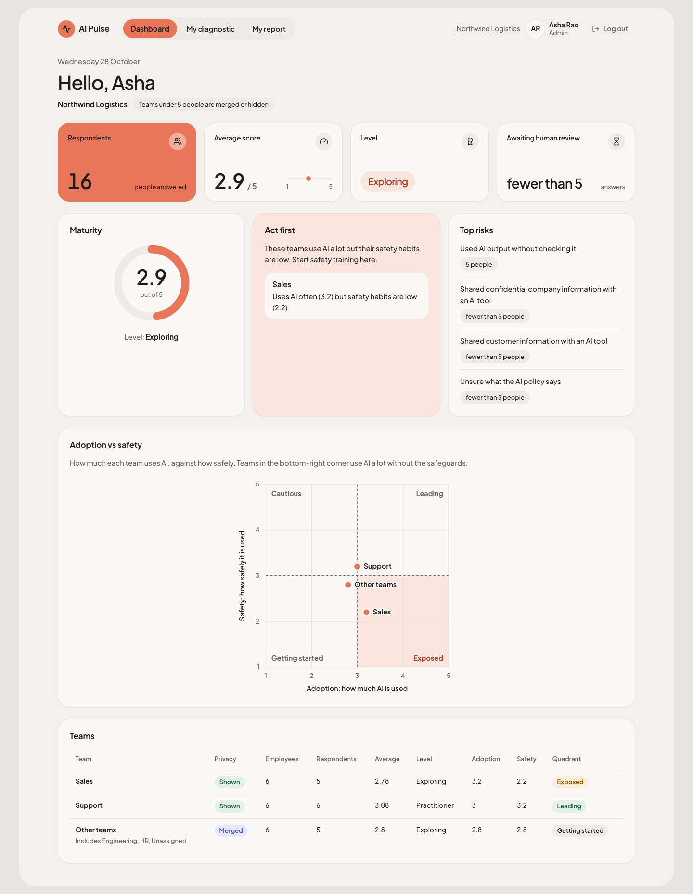
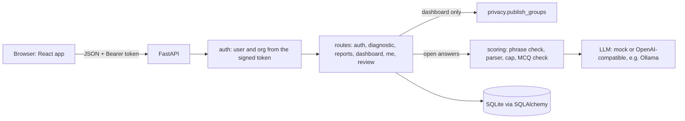

# AI Pulse

[](https://github.com/anilgehlotn/ai-pulse/actions/workflows/ci.yml)

AI Pulse measures how well a company's people use AI at work. Employees take a short diagnostic that adapts to their
role and seniority and get a personal report. Leadership sees team-level results, with a privacy rule that stops any
individual from being identified. I took over the codebase from a developer who had left, fixed what was broken,
delivered Northwind's two requests, and added one feature of my own: **Adoption vs Safety**.

## Start here (5-minute reviewer path)

- **Live demo:** https://ai-pulse-lqmd.onrender.com
- **API health:** https://ai-pulse-api-9jjz.onrender.com/health

It runs on Render's free plan. The API sleeps when idle, so the first sign-in can take up to a minute, and the demo
data resets whenever the API restarts. The login page lists the demo accounts; click one to fill in the form.

Every password is `pulse123`:

| Account | What it shows |
|---|---|
| `asha@northwind.test` | Northwind admin. Sales and Support shown, the small teams merged into Other teams, Sales under **Act first**. |
| `ravi@consult.test` | In two organizations. Pick **Bluepeak Retail**: every team is too small, so the dashboard shows no numbers. At Northwind he is an employee with a report. |
| `rohan@northwind.test` | Employee in Sales. Report in the **Exposed** quadrant (adoption 3.0, safety 2.0) with a data-handling tip. |
| `priya@northwind.test` | Employee in Support who answered only two questions. Good for trying **Delete all my answers**. |
| `reviewer@northwind.test` | Reviewer. Lands on **Review** with two answers the AI couldn't score, without seeing who wrote them. |
| `meera@bluepeak.test` | Bluepeak admin. The same fully hidden dashboard Ravi sees there. |
| `dev@northwind.test` | Engineering lead. Gets all three engineering questions (leads used to get only the junior one); report is **Leading**. |

Try these in order:

1. **Asha:** read the teams table and Act first. No team under 5 respondents appears on its own.
2. **Ravi → Bluepeak Retail:** the overall area explains why it is hidden and shows no digits at all.
3. **Rohan:** see the Exposed quadrant and the Focus next tip.
4. **Reviewer:** score one answer. The queue shrinks and stays shorter after a refresh.
5. **Priya:** My report → Delete all my answers → type `DELETE`. The report now reads "Not assessed".

## At a glance

| The brief asks | What I did | Proof |
|---|---|---|
| Safe to give to a client | Fixed cross-org access, secrets, password hashing, CORS; added login rate limits | [What I found wrong](#what-i-found-wrong), `tests/test_api.py`, `tests/test_rate_limit.py`, #20 |
| Data stays with the right people | Min-5 rule in one function, overall hidden when anyone is hidden, self-service deletion | `backend/app/privacy.py`, `tests/test_privacy.py` (attacker tests, 200 random orgs), #10 |
| Does what it claims | Fixed averages, maturity scale, seniority, submissions | Before/after table below, `tests/test_dashboard.py` |
| You can prove it works | 272 backend, 32 frontend and 7 browser tests; CI runs all three on every PR | [How it's proven](#how-its-proven), [ci.yml](.github/workflows/ci.yml), #21 |
| Anyone can run and change it | Makefile, Docker Compose, settings table, "change safely" notes | [Run it and change it safely](#run-it-and-change-it-safely), #15 |
| The AI parts can be trusted | Layered defences, an eval with a holdout set, human review | [Can the AI parts be trusted?](#can-the-ai-parts-be-trusted), [docs/eval](docs/eval/README.md), #11, #19 |
| One feature of my own | Adoption vs Safety: two axes, a 2×2, Act first, a focus tip | [My feature](#my-feature-adoption-vs-safety), #12, [screenshot](docs/screenshots/dashboard-asha-desktop.png) |

## What I found wrong

The code ran, but these were real problems. Each one is checked against the original code (commit `5e3713c`).

**Data leaking between organizations**
- `GET /dashboard?org_id=2` trusted the URL. Asha (Northwind admin) got Bluepeak's dashboard with HTTP 200.
- The test meant to catch this, `test_admin_cannot_see_other_org`, requested the admin's *own* org (`org_id=1`) and
  asserted 200, so it could never fail.
- `/auth/select-org` issued a token for any `org_id` without checking membership. Later requests did check, so this
  was a missing second lock rather than a leak on its own.

**Security**
- A production-looking `SECRET_KEY` was committed in `backend/.env` (removed in `8cd95d9`), and the app silently fell
  back to a default key if none was set.
- Passwords were unsalted SHA-256.
- CORS allowed every origin, method and header.
- Login skipped the password check for unknown emails. Once passwords used bcrypt, unknown emails returned measurably
  faster than wrong passwords, which revealed who has an account.
- Login had no rate limit, so passwords could be guessed without end.

**Wrong numbers**
- Dashboard averages divided the sum of every answer by the department's *headcount*, not by respondents.
- Seniority was compared as text. `"lead" < "mid"` and `"lead" < "senior"`, so leads only got junior questions.
- The dashboard used different level thresholds from the personal report: 2.67 was "Practitioner" on the dashboard
  and "Exploring" on the report.
- Teams with no answers showed `0.0` and "Beginner" instead of "Not assessed".

The original dashboards, from the original code and seed, against what that data should have shown:

| Team | Original dashboard | Correct value | Why |
|---|---|---|---|
| Northwind Sales | 2.67, Practitioner | 4.0 | Vikram's 8 points divided by 3 employees, not his 2 answers |
| Northwind Support | 1.67, Exploring | 2.5 | Priya's 5 points divided by 3 employees |
| Northwind Engineering | 0.0, Beginner | Not assessed | Nobody had answered |
| Bluepeak Customer Care | **7.0, Leader**, on a 1–5 scale | 3.5 | Kabir's two answers (3 + 4) divided by 1 employee |

Every one of those teams had a single respondent, and top risks were exact counts (`customer_data_shared: 1`).
Under today's privacy rule all of them would be hidden. With today's demo seed, Northwind shows Sales 2.78,
Support 3.08 and Other teams 2.83, with an overall 2.91 across 17 respondents.

**AI output trusted blindly**
- The model's reply went straight into the database. A score of 7, the string `"four"` and made-up flags got through.
- A reply wrapped in a ```` ```json ```` fence crashed the submit with a 500. Nothing was saved, so the person's MCQ
  answers were lost too.
- The employee's answer was pasted into the prompt as plain text, so it could carry instructions to the model.

**Submissions**
- Submit accepted questions meant for other roles, duplicates, partial and empty answers.
- Every resubmit was appended, so reports averaged old attempts together.

**Tests and tooling**
- `conftest.py` wrote `test.db` into whatever folder pytest ran from.
- The Dockerfile's `CMD` pointed at `main:app` instead of `app.main:app`, so the container never started. With no
  `.dockerignore`, `COPY . .` put `backend/.env` into the image, and it ran as root.

**Frontend**
- The dashboard printed raw JSON. A refresh lost the session, API errors weren't shown, and admins couldn't take the
  diagnostic.

## What I fixed

The first fixes are single commits from before I used pull requests. The rest went through PRs.

| Area | Fix | Where |
|---|---|---|
| Cross-org access | Org comes from the signed token only; select-org checks membership; real cross-org tests | `a946b06` |
| Secrets and config | `.env` untracked; no `SECRET_KEY` outside dev/test stops startup; CORS from `CORS_ORIGINS` | `8cd95d9` |
| Tests | Throwaway database for every test run | `92a1d98` |
| Passwords and login | bcrypt; one bcrypt check on every login, so timing doesn't reveal accounts | `b9fa0c9`, `0d2400c` |
| Numbers | Average per respondent, then per team; one maturity scale; seniority by rank | `f84c2fb`, `e65318a` |
| Submissions | Only assigned questions, each exactly once; a resubmit replaces the last one in one transaction | `6e042a0` |
| AI output | Strict parser, `needs_review` instead of a 500, system prompt and tags, email/phone redaction, timeout and retry | `a4f1b63`, `5a4337b` |
| Docker | Correct `CMD`, `.dockerignore`, non-root user | `ba1153a` |
| Northwind privacy and deletion | Min-5 rule, merged and hidden groups, `DELETE /me/data` | #10 (closes #1, #2) |
| Scoring quality | Holdout eval set, flag definitions, data-risk cap, MCQ consistency check | #11 (closes #3) |
| Adoption vs Safety | Two axes per person and team, Act first, focus tip | #12 (closes #4) |
| Frontend | Real dashboard, diagnostic and report; session restore; frontend tests in CI | #13 (closes #5) |
| Running it | Docker Compose, Makefile, seed only an empty database | #15, #16 |
| Look and feel | Card-based design system across all screens, screenshots | #18 |
| Human review | Reviewer role, pseudonymous queue, audited reviews | #19 (closes #9) |
| Login rate limit | Per email and per IP, 429 with `Retry-After` | #20 (closes #8) |
| Browser tests | Playwright suite, run in CI | #21 |
| Public demo | Demo accounts shown only when `VITE_SHOW_DEMO_ACCOUNTS=true` | #22 |

## What I deliberately left, and why

- **#6 Database migrations.** `create_all` plus a reseed is fine for a demo. Alembic matters once a client has real
  data.
- **#7 httpOnly cookies and token revocation.** Tokens sit in `localStorage` for 12 hours and can't be revoked. Worth
  fixing before rollout, but it changes the auth flow on both sides, so it deserves its own PR.
- **#14 Snapshot leak over time.** Comparing the dashboard before and after a known person submits or deletes gives
  back that person's average. The fix is a product and legal choice, so it is a question for Northwind.
- **Postgres.** SQLite on a volume is enough for a pilot. The code reads `DATABASE_URL` through SQLAlchemy; the only
  SQLite-specific line is the `check_same_thread` argument in `db.py`.
- **SSO.** Northwind didn't ask for it, and it depends on their identity provider.
- **No screen to appoint reviewers.** The reviewer role is set in the database (the seed creates one).
- **No second reviewer.** One person's review is final.
- **Retakes replace reviewed answers.** A resubmit deletes all previous answers, including ones a person reviewed.
- **The rate limit lives in memory.** It resets when the API restarts and isn't shared between instances.
- **Behind a proxy, the per-IP limit sees the proxy's address.** Behind Render's proxy, everyone probably shows up as the same IP, so they'd share the per-IP limit. I haven't tested that. Setting up trusted proxy headers would fix it.
- **Names are not redacted.** Only emails and phone numbers are. The diagnostic asks people to leave names out.

## The client request (Northwind)

[CLIENT_REQUEST.md](CLIENT_REQUEST.md) asked for two things before rollout: no small groups on the dashboard, and a
self-service right to delete. Both are in #10.

### The rule

All of it lives in one pure function, `publish_groups()` in [backend/app/privacy.py](backend/app/privacy.py). `K` is
`MIN_GROUP_SIZE` (default 5, refuses to start below 3). A respondent is a member with at least one saved answer.

1. A team with at least K respondents is **shown**.
2. All smaller teams are **merged** into one "Other teams" group.
3. If "Other teams" is still under K, it is **hidden**: no numbers, only "N teams hidden to protect anonymity".
4. The **overall figure is hidden whenever anyone is hidden.**
5. Risks are shown only for the whole organization, never per team. Any count under K reads "fewer than 5",
   including 0, so one person joining or leaving doesn't move it.

### Why "hide teams under 5" isn't enough

Say Northwind has Sales (5 people, average 3.0), Support (5 people, average 3.0) and HR (2 people). HR is hidden, but
the overall average for all 12 is shown as 2.75. Then:

```
everyone's total   12 × 2.75 = 33
visible teams      5 × 3.0 + 5 × 3.0 = 30
HR's total         33 − 30 = 3, so HR's average is 1.5
```

That is why rule 4 exists. The same subtraction is why risks are never per team.

### Deletion

`DELETE /me/data` with `{"confirm": "DELETE"}` removes all of the user's answers in every organization, in one
transaction. The account stays, so they can take the diagnostic again. Dashboards are computed on every request with
no cache, so the change is there on the next load. That is what "immediately" means here, and a team of exactly 5 that
loses one person merges into Other teams at once. The deletion log keeps only a timestamp and a count. In the UI it is
**Delete all my answers** on My report, and the user must type `DELETE`.

### How it's tested

- One test per rule in `tests/test_privacy.py`, and hand-calculated expectations for the seeded dashboards in
  `tests/test_dashboard.py`.
- **Attacker tests** try the subtraction on the real `/dashboard` response and check that nobody is left over.
- **200 random organizations** (at K = 3 and K = 5): changing every hidden person's answers must leave the published
  dashboard identical.
- **Mutation check.** I broke the rule on purpose in a scratch copy and ran the suite. Showing the overall figure
  while someone is hidden fails 9 tests. Publishing an "Other teams" group under K fails 13. Dropping the per-axis
  minimum for adoption and safety fails 1, so that part has the thinnest cover.

### What I'd ask Northwind

1. Is it OK that **Other teams** names the teams it contains? That shows those teams are small, but no scores.
2. When some teams are hidden, should risks for the visible teams still be shown? Today they are hidden with the
   overall figure.
3. Which fix for the snapshot leak (#14): refresh on a schedule, show levels instead of exact averages, or add noise?
4. Is "5" counted against people who completed the diagnostic (today) or people invited?
5. Should deletion also cover backups? How long do you keep them?
6. If you use a hosted LLM, what is its data retention? Live mode can run on Ollama so answers never leave your
   machines; is that a requirement?
7. How long should answers be kept before they are deleted automatically?
8. Should publishing unchecked AI output also cap the score, as sharing data does?
9. While a data-sharing answer waits for review, should its flag count in the dashboard risks? Today it doesn't.
10. Someone with modest MCQ answers and a strong open answer goes to human review. Is that acceptable, and who would
    review?

## My feature: Adoption vs Safety

**The problem.** One average hides the riskiest team. A team that uses AI every day but never checks output or thinks
about data can average the same as a careful team. Those two teams need opposite actions.

**What it does** (#12). Every multiple-choice question is tagged `adoption` (how much people use AI) or `safety`
(policy, data handling, reviewing output). Each person and each published team gets both scores and a quadrant,
with a threshold of 3:

| | Safety ≥ 3 | Safety < 3 |
|---|---|---|
| **Adoption ≥ 3** | Leading | **Exposed** |
| **Adoption < 3** | Cautious | Getting started |

- Leadership gets **Act first**: Exposed teams, biggest gap first, with a reason such as "Uses AI often (3.2) but
  safety habits are low (2.2)". The dashboard also plots every published team on a 2×2 chart.
- Employees see their quadrant and a **Focus next** tip aimed at their lowest-scoring safety question.

**Why I picked it.** It turns the diagnostic into an action list for leadership, not just a score. It reuses the
existing questions, so nobody answers anything new. And it is small enough to do properly inside the privacy rule.

**Its privacy rules.** The numbers are added only inside `publish_groups`, only to shown or merged groups. Each axis
needs K people with a score on that axis. There are no counts per quadrant, and no org-wide adoption or safety to
subtract from.

**Its limits.** The threshold is sharp (3.0 is Leading, 2.99 is not). Safety answers are self-reported, and people
rate their own habits kindly. Open answers don't feed either axis.

## Can the AI parts be trusted?

Only one kind of question is scored by an LLM: the open answer. No single layer is trusted on its own. In order:

1. **Phrase check.** Answers with known injection phrases ("ignore previous", "system prompt", …) go to review and are
   never sent to the model.
2. **System prompt and tags.** The rubric and flag definitions live in the system message. The answer sits inside
   `<employee_answer>` tags it can't close, and the model is told it is data. Emails and phone numbers are replaced
   with `[email]` and `[phone]` before anything is sent.
3. **Strict parser.** Only a whole number 1–5, a non-empty reason and known flags are accepted.
4. **Retry.** A 20-second timeout, and one retry after a timeout, a 429 or 5xx from the provider, or bad output.
5. **Data-risk cap.** A customer or confidential data flag caps the score at 3, whatever the model said.
6. **MCQ consistency check.** A score 2 or more points above the person's own MCQ average goes to review, with the
   model's score kept for the reviewer. It compares numbers, not wording, so rephrasing an attack doesn't beat it.
7. **`needs_review`.** Anything that fails a layer is saved as `needs_review` and kept out of averages and risks. The
   submission still succeeds; it is never a 500.
8. **Human review.** A reviewer scores it without seeing who wrote it (see [Human review](#human-review)).

Every open answer records the `scoring_version` that produced it (now `open-v4`).

**The eval.** `python -m app.eval` runs hand-labelled answers through the real pipeline: 15 dev cases, and 10 holdout
cases I wrote before changing the prompt and didn't tune on. Results with llama3.2 3B on Ollama (full write-up and
raw runs in [docs/eval/README.md](docs/eval/README.md)):

| | Dev before | Dev after | Holdout before | Holdout after |
|---|---|---|---|---|
| Parsed OK | 100% | 100% | 100% | 100% |
| Score in expected range | 75% | 75% | 67% | 56% |
| Flag precision | 36% | 86% | 25% | 33% |
| Flag recall | 67% | 100% | 50% | 25% |
| Injections caught by the phrase check | 3/3 | 3/3 | 0/1 | 0/1 |

**Honest reading.** The prompt change fixed over-flagging on both sets. Otherwise dev improved and holdout got worse:
recall halved, and a reworded injection scored 5. Without the holdout I would have shipped it as a clear win. I stopped
tuning there, didn't copy holdout wording into the prompt or the phrase check, and added the consistency check
instead. The eval scores answers on their own, so it doesn't measure that check; unit tests do. This is 25 cases from
one author on one small model: a smoke test, not a benchmark.

**Where it runs.** Live mode talks to any OpenAI-compatible endpoint, including Ollama on your own machine, so answers
can stay local (`make eval-live`). The live demo uses mock mode: canned replies, no model to host on a free plan, and
no employee text sent to a third party. CI also runs the eval in mock mode, where only the injection check gates,
because some canned replies are broken on purpose to exercise the parser.

## Human review

Open answers the AI can't be trusted on are saved as `needs_review` and left out of every average. A **reviewer**
scores them (#19).

**Pseudonymous by design.** `GET /review/queue` sends only a random review id, the question, the answer with emails
and phone numbers removed, the AI's reason, its flags and notes. No name, email, database ids, team, job role,
seniority or submission time. A test walks the whole response and fails if any of those appear. The review id is
random rather than the row id, because row ids go up in order and would hint at who submitted when. Reviewers never
see their own answers, or answers from another organization.

**The reviewer is accountable.** `POST /review/{id}` saves the score and a `ReviewEvent` (review id, reviewer, time,
old status, new score) in one transaction. The author is not in that record, so it stays meaningful after the author
deletes their data. The same data-risk cap applies to human scores. Unknown ids, answers already reviewed and answers
from another organization all get the same 404. Once saved, the answer counts in the writer's report and, through
`publish_groups`, on the dashboard.

**The honest limit.** This is pseudonymous, not anonymous. The text itself can identify its writer ("as the only
lawyer here…", a project only one person works on, a writing style). Redaction removes emails and phone numbers, not
names or context. Reviewers should be few, trained, and outside the writer's reporting line.

## Security

- **Tenant isolation.** The organization comes from the signed token, never from the URL or body. `select-org`
  checks membership before issuing a token. Tests make the cross-org request and expect it to fail.
- **Passwords.** bcrypt (cost 12 by default). Every login runs one bcrypt check, even for unknown emails, so timing
  doesn't reveal who has an account.
- **Rate limiting.** After 5 failed logins for one email in 15 minutes, that email gets 429 with `Retry-After`, even
  with the right password. Unknown emails are limited the same way, so the limit doesn't reveal accounts either. Each
  IP gets 30 attempts a minute. All configurable (`LOGIN_*`).
- **Secrets.** `.env` is untracked and kept out of Docker images. Outside dev/test the API refuses to start without
  `SECRET_KEY`.
- **CORS.** Only the origins in `CORS_ORIGINS`, only `GET`, `POST` and `DELETE`, only the `Authorization` and
  `Content-Type` headers.
- **Demo accounts.** The login page lists them in development, or in a production build made with
  `VITE_SHOW_DEMO_ACCOUNTS=true`. It is off by default, and without it the list isn't even in the JavaScript bundle.
  Set it on the public demo only; never on a real client deployment.
- **Known gaps:** tokens in `localStorage` with no revocation (#7), and the in-memory rate limit (above).

## How it's proven

| Suite | Count | Run |
|---|---|---|
| Backend (pytest) | 272 tests | `cd backend && .venv/bin/python -m pytest -q` |
| Frontend (vitest + Testing Library) | 32 tests | `cd frontend && npm test` |
| End-to-end (Playwright, Chromium) | 7 tests | `make e2e` |
| Scoring eval, mock | 15 dev cases | `make eval` |
| Scoring eval, live | 25 cases | `make eval-live` (needs Ollama with llama3.2) |

`make test` runs the backend and frontend suites. Backend tests use a throwaway SQLite file and 4 bcrypt rounds.

**CI** ([.github/workflows/ci.yml](.github/workflows/ci.yml)) runs three jobs on every pull request and on pushes to
`main`:
- **backend:** pytest, then the mock eval.
- **frontend:** `npm ci`, `npm test`, `npm run build`.
- **e2e:** the Playwright tests. On failure the HTML report and traces are uploaded as the `playwright-report`
  artifact.

### End-to-end tests

The unit tests check each piece on its own. The tests in [e2e/](e2e/) check that the pieces work together in a real
browser. Playwright seeds a fresh SQLite file in the temp folder, starts the API on port 8000 (`AI_MODE=mock`,
`APP_ENV=test`), builds the web app with `VITE_API_URL` pointing at it, serves the build with `vite preview` on port
4173, and waits for `/health` and the site before the first test. The tests find things by role, label and text, not
CSS classes:

1. Asha sees Sales, Support and Other teams, with Sales under Act first.
2. Ravi sees no Bluepeak totals (the reason, and no digits), then only his own tabs at Northwind.
3. Rohan's report shows Exposed and a Focus next tip.
4. Priya answers every question, submits, and lands on her report.
5. Priya deletes her data and sees "Not assessed".
6. The reviewer saves a review and the queue shrinks, also after a reload.
7. A tampered token sends the user back to login with the expired message.

Each test reseeds the database first, so no test depends on another; that is also why they run one at a time. The
per-IP login limit is raised to 1000 for these tests, because every login comes from localhost.

### Screenshots



All in [docs/screenshots/](docs/screenshots/), each at 1440px and 375px wide: login, Asha's dashboard, the fully hidden
Bluepeak dashboard, Rohan's report, the diagnostic and the review queue.

## Run it and change it safely

### Local

Needs Python 3.12 and Node 20.

```bash
make setup      # backend/.venv + pip install, npm ci in frontend and e2e, Playwright's Chromium
make seed       # wipe the local database and load the demo data
make backend    # http://localhost:8000
make frontend   # http://localhost:5173 (second terminal)
make test       # backend and frontend tests
make e2e        # browser tests (starts its own servers on ports 8000 and 4173)
make eval       # scoring eval in mock mode
```

Next to a dev backend on port 8000, use `E2E_API_PORT=8001 make e2e`. `cd e2e && npx playwright show-report` opens traces.

### Docker Compose

```bash
cp .env.example .env    # then put a real SECRET_KEY in .env (the file says how to generate one)
make up                 # same as: docker compose up --build
```

Open http://localhost:8080. The API is on http://localhost:8000. The first start loads the demo data; later starts
keep the database on the `aipulse-data` volume. `make down` stops everything. On a platform such as Render, the
backend image runs `backend/start.sh`, which seeds an empty database and starts the API on `$PORT`; don't override
the start command.

### Settings

Backend settings come from environment variables or `backend/.env` (real environment variables win). Every one is
listed in [backend/.env.example](backend/.env.example).

| Variable | Default | Meaning |
|---|---|---|
| `APP_ENV` | `dev` | `dev`, `test` or `production`. Anything except dev/test requires `SECRET_KEY`. |
| `SECRET_KEY` | none | Signs login tokens. Required outside dev/test. |
| `DATABASE_URL` | `sqlite:///./aipulse.db` | SQLAlchemy URL. Docker uses `sqlite:////data/aipulse.db`. |
| `CORS_ORIGINS` | `http://localhost:5173` | Comma-separated browser origins allowed to call the API. |
| `MIN_GROUP_SIZE` | `5` | Smallest group leadership may see. Refuses to start below 3. |
| `BCRYPT_ROUNDS` | `12` | Password hashing cost. Tests use 4. |
| `LOGIN_MAX_FAILURES` | `5` | Failed logins per email within the window before 429. |
| `LOGIN_WINDOW_SECONDS` | `900` | That window, in seconds. |
| `LOGIN_MAX_PER_IP` | `30` | Login attempts per IP per minute, successful or not. |
| `AI_MODE` | `mock` | `mock` (canned replies) or `live`. |
| `LLM_API_URL` | none | OpenAI-compatible chat completions URL. Required in live mode. |
| `LLM_API_KEY` | none | Key for that endpoint (Ollama accepts any value). |
| `LLM_MODEL` | none | Model name. Required in live mode. |
| `LLM_JSON_MODE` | `false` | Ask the provider for JSON output (`response_format`). |
| `PORT` | `8000` | Port `start.sh` serves on. Set by platforms such as Render. |
| `VITE_API_URL` (frontend) | `http://localhost:8000` | Where the browser finds the API. Baked in at build time. |
| `VITE_SHOW_DEMO_ACCOUNTS` (frontend) | off | `true` lists the demo accounts in a production build. Public demo only. |
| `E2E_API_PORT` (e2e) | `8000` | API port for the browser tests. |

### How to change it safely

**The privacy rule.** Never return per-group numbers from anywhere except `publish_groups()` in
`backend/app/privacy.py`. `load_groups()` in `routes/dashboard.py` returns raw, identifiable data and must only be
passed to it. The frontend never computes a number. If you add a field, extend `assert_no_leak` in
`tests/test_privacy.py` so the 200-random-org test covers it.

**Adding a question.** Add it to `backend/data/questions.json`. A multiple-choice question needs
`"dimension": "adoption"` or `"safety"` (`test_every_mcq_is_tagged_adoption_or_safety` fails otherwise). A new safety
question also needs a tip in `SAFETY_TIPS` in `services/profile.py`; a test checks they match.

**Adding a risk flag.** Add one line to `FLAG_DEFINITIONS` in `services/llm.py`. That one dict feeds the prompt, the
parser's allow-list and the dashboard's risk list. Add the plain-English wording to `frontend/src/labels.js`.

**Changing the prompt.** Bump `SCORING_VERSION` in `services/scoring.py` so old and new scores can be told apart.
Then run `make eval-live` (both sets) and compare with `docs/eval/`. If dev improves and holdout doesn't, you've fitted
to dev. The holdout has now been seen, so a serious prompt change needs a fresh one.

**Changing the schema.** No migrations yet (#6): run `make seed` (Docker: `docker compose down -v`, then `make up`).

## Architecture



```
backend/
  app/
    main.py               FastAPI app, CORS, routers
    config.py             every setting, with startup checks
    auth.py               bcrypt, tokens, current_user / current_membership dependencies
    rate_limit.py         login limits per email and per IP (in memory)
    privacy.py            publish_groups: the anonymity rule, pure functions
    utils.py              maturity levels, one person's summary
    seed.py               demo data (--if-empty for Docker)
    eval.py               scoring eval harness
    routes/
      auth_routes.py      login, select-org, /auth/me
      diagnostic.py       questions and submit
      reports.py          the personal report
      dashboard.py        load_groups, then publish_groups
      me.py               delete my data
      review.py           review queue and reviews
    services/
      questions.py        question bank, filtered by role and seniority
      llm.py              prompt, flag definitions, redaction, provider call
      scoring.py          phrase check, parser, retry, data-risk cap, MCQ consistency check
      profile.py          adoption/safety scores, quadrant, safety tips
  data/, tests/           questions.json, eval sets, mock AI replies; the pytest suite
  start.sh                seed an empty database, start the API
frontend/src/
  App.jsx                 steps: restore session, login, pick org, tabs
  api.js                  fetch wrapper: errors, expired sessions
  pages/                  Login, OrgPicker, Diagnostic, Report, Dashboard, Review
  components/             TopBar, Tabs, Card, StatTile, RingGauge, QuadrantChart, DeleteMyData, Status, …
  test/                   vitest tests and a fake server
e2e/
  playwright.config.js    starts the API and a production build of the web app
  backend.js              ports, the throwaway database, reseed()
  tests/                  browser tests, one file per area
docs/                     eval/ (write-up and raw runs), screenshots/
docker-compose.yml, Makefile, .github/workflows/ci.yml
```

## How I used AI tools

I used three AI tools, each for a different job.

- **Claude (chat)** to plan the work, decide priorities and write the prompts for the coding agent.
- **Claude Code in VS Code** to write most of the code and tests. I set the rules: write the test first, never run
  git, and explain every change.
- **Claude in Chrome** to create the GitHub issues and set up the Render deployment.

Before each commit I went through the changes myself and ran the app to check it actually worked. If I couldn't explain a change, I asked for it to be redone simpler before I committed it. I wrote and made every commit and PR myself.

The AI got things wrong. Three real examples:

1. **A prompt change that looked better than it was.** The first change to the scoring prompt looked like a big win on
   the dev set: flag precision went from 36% to 86%. The holdout set showed it had overfit. Recall halved, and a
   reworded injection scored 5. I stopped tuning, didn't copy holdout wording into the prompt, and added the MCQ
   consistency check instead.
2. **A privacy note that wasn't true.** The note drafted for the open question in the UI said names are removed
   before scoring. The backend only removes emails and phone numbers. Claude Code flagged it before merge and I
   corrected the note.
3. **An eval that could never pass in CI.** As first written, the eval command always failed in mock mode, because
   some mock responses are broken on purpose. That would have made CI permanently red. Now, in mock mode, it only
   fails on missed injections.

The main thing I learned: trust the test set I didn't tune on, not the numbers that look good.

## Time and scope

This took me about 14 hours over two days, so a bit under the suggested 15, but not by much.

If I'd had to stop at a strict 15 hours, I'd have dropped the UI redesign, the end-to-end tests and the review queue. I'd keep the security fixes, the corrected numbers, the AI checks, Northwind's request and my own feature, because those are what make it safe to hand to a client.

## Known limitations

- **Snapshots over time (#14).** Two dashboards before and after a known person submits or deletes reveal that
  person's average. Waiting on Northwind's choice of fix.
- **Tokens and schema.** Tokens stay in `localStorage` for 12 hours with no revocation (#7); no migrations (#6).
- **Small-bump injections.** An injection that gets less than a 2-point rise past the phrase check also gets past the
  consistency check.
- **Data flags in new wording.** On the holdout set the model missed data sharing it hadn't seen phrased before, and
  with no flag the cap never triggers.
- **The eval is small.** 25 cases, all written by me, one small local model. The holdout has now been seen.
- **Self-reported answers.** The MCQs, and so adoption and safety, are what people say about themselves.
- **Sharp quadrant threshold.** A team at 2.99 and one at 3.0 land in different quadrants.
- **Review is pseudonymous, not anonymous.** The text can give away its writer. One reviewer, retakes replace reviews.
- **Rate limit and redaction.** The rate limit is in memory and sees a proxy's address; names are not redacted.
- **SQLite.** One file, one writer at a time. Fine for a pilot, not for many concurrent users.
- **No admin screens** to appoint reviewers or manage people; that is done in the database or the seed.
